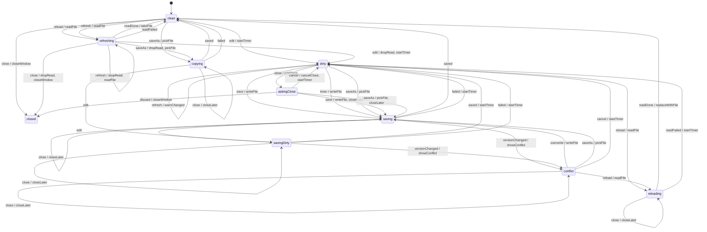

# Architecture

Cellestra is one TypeScript code base with three hosts and a command line. The browser, the NAS server's client and the Electron app all run the same engine and UI. The only thing that differs between them is where files come from. The `cellestra` CLI runs the same engine in Node, without the UI.

```
            ┌──────────────── apps/web (the app shell) ──────────────────────┐
            │  App · Ribbon · AppController · commands · DocumentStores      │
            └──────────────────────────────┬─────────────────────────────────┘
                                           │ imports
            ┌──────────────── packages/ui (Preact + signals) ────────────────┐
            │  Grid (canvas) · FormulaBar · SheetTabs · ⌘K · dialogs         │
            │  WorkbookSession (undo, selection, dirty) · CommandCatalog     │
            │  FileStore ─┬─ BrowserStore  (File System Access / upload)     │
            │             ├─ NasStore      (fetch /api, ETag)                │
            │             └─ NativeStore   (window.cellestraNative IPC)      │
            └──────────────────────────────┬─────────────────────────────────┘
                                           │ imports
            ┌──────────────── packages/core (pure TS) ───────────────────────┐
            │  values · model · formulas · dependencies (recalc) · editing   │
            │  data (sort/filter/tables/validation) · styling · xml          │
            │  serialization (ods, xlsx read, csv) · printing                │
            └──────────────────────────────┬─────────────────────────────────┘
                                           │
                               packages/charts (model + ODF chart XML)

 apps/web      the app shell + Vite entry; static build with relative URLs (base './')
 apps/cli      the cellestra command line; imports packages/core only
 apps/server   node:http: static client + /api/{info,roots,list,file}
 apps/desktop  Electron main + sandboxed preload; loads apps/web build via app://
```

## Core (`packages/core`)

- **Values.** `CellValue` is a discriminated union (`empty | number | text | boolean | error`). Spreadsheet errors are values; evaluation never throws for them.
- **Model.** `Workbook` holds `Worksheet[]`, a `StylePool` and `DocumentSettings`.
  - A worksheet keeps its cells in one `Map<number, Cell>` keyed by `row * 16384 + col`, so there is no 2-D array and no object for each empty cell.
  - Rows and columns that differ from the defaults are kept in their own sparse maps.
  - Styles are interned: a cell stores a style id.
- **Formulas.** The pipeline is lexer → parser (AST) → evaluator. `FunctionRegistry` holds every function together with its metadata, which also drives autocomplete and help. A function's traits sit on the function itself: `volatile` (TODAY, NOW), `trapsErrors` (IFERROR) and `extraReads` (cells it reads beyond its arguments, as SUMIF does). `evaluateFormula` is the one way to evaluate a parsed formula against a workbook; the recalculation engine and the CLI both use it. `OpenFormulaTranslator` converts between the internal syntax (`SUM(A1:A3)`) and ODF's (`of:=SUM([.A1:.A3])`).
- **Dependencies.** `RecalculationEngine` covers full recalc, recalc after an edit, re-planning after a structural edit (`recordStructuralChange`), volatile functions, manual mode (where neither kind of edit evaluates anything until a full recalc), and cycle detection, which shows `#REF!`. `RecalculationEngine.apply(edit)` takes an edit's result and decides what to recalculate, manual mode included; callers don't check the mode themselves.
- **Editing.** Every model change is an edit command with apply and revert. The app and the CLI share them (for example `DataEditCommands` for tables, AutoFilter, validation and named ranges), so both make the same change. A command that won't make an edit (sorting over a merge) throws `EditRefusedError`. `EditHistory` keeps up to 1,000 of them. Structural edits rewrite formula references through `ReferenceAdjuster`.
- **Serialization.**
  - `.ods` is read and written through a small namespace-aware XML tree, so elements Cellestra doesn't model survive a round trip verbatim.
  - The `mimetype` entry is always first in the zip and stored uncompressed.
  - Cell values are read and written in `odsCellValue.ts`, and named ranges in `odsNamedExpressions.ts`.
  - CSV is RFC 4180.
- **Charts.** The chart model and its ODF XML live in `packages/charts`, which knows nothing of the engine. `ChartDataResolver` turns a chart's ranges into numbers and labels for drawing. A chart bound to a table (`ChartDefinition.source`) goes through `ChartTableBinding.materialize` first, which rebuilds its ranges from the table's current range and header names; the resolver, the ODS writer and the CLI all read charts through it, so a bound chart follows its table everywhere. Rename Table rewrites the bindings in the same edit. `ChartGrouping` then merges rows that repeat a category label by the chart's aggregate (not on scatter or bubble charts). The chart panel (`ChartSheetView`, `ChartTableFields` in `packages/ui`) only renders; its rules (Table ↔ Range, which columns a type plots, the reference a Pick on sheet fills) are `ChartTableBinding` and `ChartFields` in core.
- **Printing and conditional formats.** `printHtml` turns a sheet and its page setup into a printable HTML document, and `conditionalFormatRules.ts` turns a cell's conditional styles into editable rules and back. Both are pure, so the app's dialogs and the CLI's `print` and `conditional` commands share them.
- **Locale.** All number, date and collation behaviour goes through `Intl`. A document's locale is a BCP-47 tag; if it has none, the host's locale is used (set through `setHostLocale` at startup).

## UI (`packages/ui`)

- **Grid.** The grid is a single `<canvas>` over a native scroller.
  - `Axis` stores only the rows and columns with non-default sizes, as prefix sums, so offsets and hit-tests are O(log n) even with a million rows.
  - `Viewport` is the geometry for one frame: frozen panes, zoom and visible bands. Rendering, hit-testing and the inline editor all use it.
  - The renderer reads the `Worksheet` directly.
  - `cellText.ts` measures cell text: the font, padding and line height the renderer, row heights and column autofit all use.
  - `navigation.ts` turns keys into grid actions and steps the active cell over hidden lines and merges; `sheetLayout.ts` holds the sheet's axes and content extent.
  - The editor is a `<textarea>` placed over the active cell, so IME works.
- **State.** Signals hold the chrome state: selection, zoom, theme and a document version counter. The grid redraws whenever the version changes.
- **Commands.** `CommandCatalog` is the one list of commands. The toolbar, ⌘K, the shortcut dispatcher and the Electron menu bar (sent over IPC) all read it. Shortcuts are written once as `mod+shift+k` and formatted for each platform.
- **Files.** `FileStore` has three implementations, and the UI only ever sees the interface. Stores with their own dialogs (browser, native) are also a `FilePicker` (`pick`, `saveAs`). In `apps/web`, `DocumentStores` chooses the store for a document and the picker for Open and Save As (native, then the NAS through the app's folder dialog, then the browser).
  - Conflict detection uses an ETag (NAS) or a SHA-256 hash of the file's contents (native), so an edit that keeps the size and mtime is still caught.
  - The server can't push changes, so while a NAS document is open the client polls its ETag with `HEAD /api/file` every 30 seconds (`ChangePoller`), and not while the tab is hidden. A new ETag on a document without local edits offers to reload it; with local edits it only warns, and the save then meets the server's `If-Match` check and the usual conflict dialog.
  - The NAS store exists only in a NAS build (`VITE_CELLESTRA_NAS=1`: the Docker image, `just build-web-nas`, `just run-web`, `just preview-web`). A NAS build still shows NAS open and save only after the server answers `/api/info`. Every other build, the desktop app included, never contacts the server and shows nothing about a NAS.
  - IndexedDB keeps the recent files (including browser file handles) and a crash-recovery snapshot.

## App shell (`apps/web`)

- `App.tsx` lays out the ribbon, grid, formula bar, sheet tabs and dialogs. `AppController` owns the open document, saving, autosave and the dialogs' state. `commands.ts` builds the command catalog from the controller, and `nativeMenu.ts` sends it to the Electron menu bar.
- `DocumentLifecycle` opens, saves, auto-saves, reloads and closes the open document. The rules for saving are a table in `saveChart.ts`; the lifecycle keeps the state, runs the writes, reads and questions the table asks for, and sends their results back as events.

### The save chart

Every move the save session can make, from `toMermaid()` in `apps/web/src/app/saveChart.ts`; a test checks this drawing matches the table. An event with no arrow from the current state changes nothing. To review a change to saving, read this diagram's diff and ask what happens to the user's edits in each state. After changing the table, run `just diagram` to redraw it.



## CLI (`apps/cli`)

- `cellestra` reads and edits `.ods` and CSV files from the command line, for scripts, CI and agents. It runs from source with Node's type stripping and depends on `packages/core` only.
- Edits go through core's edit commands. Results are brought up to date through `RecalculationEngine.apply`, so a workbook in manual calculation keeps its old results until `cellestra recalc`. Saving follows the server's rules (atomic replace, hard links written in place, read-only files refused).
- A mistake the user can fix prints one `cellestra: <message>` line and exits 1 (2 for a bad command line). Anything else is a bug and keeps its stack trace.

## Server (`apps/server`)

- **Roots.** `CELLESTRA_ROOTS=Name=/dir;...` names the folders the server exposes.
- **Paths.** Every path is jailed to its root. This includes escapes through `..`, absolute paths, NUL bytes and symlinks.
- **Writes.**
  - Each save is atomic: temp file, then fsync, then rename, then fsync the folder so the rename is on disk too (skipped where the platform can't fsync a folder). The desktop app saves the same way.
  - `If-Match` gives optimistic concurrency (412 if the file changed). `If-None-Match: *` stops a new file from overwriting an existing one.
  - The server sends strong ETags (a hash of the bytes). `If-Match` and `If-None-Match` accept a list of tags and ignore a `W/` prefix, so a tag a proxy weakened still matches.
  - A LibreOffice `.~lock` file next to the target blocks the save (423). Overwriting after a conflict (`force=1`) skips only the `If-Match` check, never the lock; only `ignoreLock=1`, sent once the user chose Overwrite in the "open elsewhere" dialog, skips the lock.
  - Reading a file also sends the text of a LibreOffice `.~lock.<name>#` beside it, percent-encoded in an `X-Cellestra-Lock` header, so the client can say who has it open. The server never writes or removes a lock file.
  - Only `.ods`, `.csv` and `.tsv` files can be read or written, and no path segment may start with a dot.
  - Writes to one file are serialized, so the If-Match check and the rename cannot interleave. If-Match on a missing file is 412.
  - The replacement keeps the file's mode and, where permitted, its owner.
  - A file the server may not write (for example mode `0444`) is refused with 403, not replaced. The desktop app refuses it the same way.
  - A hard-linked file is written in place, because a rename would split the link. That write is not atomic: the new bytes go over the old ones, then the file is cut to length and fsynced. A crash part-way can leave a mix of new and old bytes, but never an empty file.
- **Auth.** `CELLESTRA_TOKEN` makes every `/api` call except `/api/info` need a bearer token. The server refuses to start on a non-loopback address without one, unless `CELLESTRA_NO_AUTH=1` says a reverse proxy in front authenticates. On a loopback address it runs without a token.
- **Host check.** Without a token, a request whose `Host` is not an IP literal, `localhost`, or a name in `CELLESTRA_HOSTS` gets 421. This blocks DNS rebinding.

## Desktop (`apps/desktop`)

- **Isolation.** The renderer runs with `sandbox`, `contextIsolation` and no Node.
- **Fuses.** Packaging flips Electron's fuses (`electronFuses` in `electron-builder.yml`) before signing: no `ELECTRON_RUN_AS_NODE`, no `NODE_OPTIONS`, no `--inspect` flags, and only the integrity-checked `app.asar` loads. File protocol privileges stay at Electron's default, because printing loads a temporary `file://` page. So no other program can reuse the signed binary as a Node.js runtime.
- **Key lookup.** While Keyboard Shortcuts looks up keys, `before-input-event` holds key-downs back from the menu bar and sends them to the page (`keyCapture.ts`). Escape always goes through and ends the capture, as do the window losing focus, a navigation and a renderer crash.
- **Bridge.** The preload exposes exactly one object, `window.cellestraNative`. Its contract is in `bridge.ts` and is mirrored in `packages/ui/src/platform/native.ts`.
- **Loading.** The UI loads from `app://cellestra/`, a privileged standard scheme backed by `out/web`. Navigation away from it is blocked, and links open in the system browser.
- **Main process.** It handles open and save dialogs, atomic saves with a content-hash conflict check, the native menu (built from the renderer's catalog), document state (title, the edited dot, represented file), the close guard, the external-change watcher, recent documents, and file associations through `open-file` and argv.
- **Bridge checks.** Every IPC call must come from an `app://cellestra/` frame. The renderer may only read, save and watch `.ods`/`.csv`/`.tsv` paths the user handed over (a dialog, `open-file`, argv, or an earlier open, kept in `granted-files.json` under userData); any other path asks the user first.
- **Menus.** The menu bar is the renderer's catalog plus the platform's standard menus: the app menu (macOS, with Quit), a Window menu (Minimize, Zoom, and Bring All to Front on macOS) and, on Windows and Linux, Quit at the end of File. File › Close (`⌘W`) runs the same unsaved-changes prompt as closing the window.
- **Closing.** The preload acknowledges a close request at once. If no ack arrives within 3 s, or the renderer is unresponsive, the user may force the close; a crashed renderer closes without asking. Cmd+Q quits after the unsaved-changes prompt, and a cancelled prompt cancels the quit.
- **LibreOffice locks.** Opening a file also reads a `.~lock.<name>#` beside it, if there is one, and hands its text to the renderer, which warns who has the file open. Lock files are only read, never written or removed.
- **Watcher.** It watches the file's folder (filtered by name, debounced), so it survives atomic replaces, and ignores mtimes it wrote itself.
- **App icon.** The source is `assets/icon.svg` (a 1024 canvas on Apple's icon grid). `just icons` renders it with Inkscape into `apps/desktop/build/icon.icns`, `icon.ico` and `icon.png`. Those files are committed, so packaging doesn't need Inkscape.

## Working on it

Setup, commands and workflows are in the [development guide](development.md).
